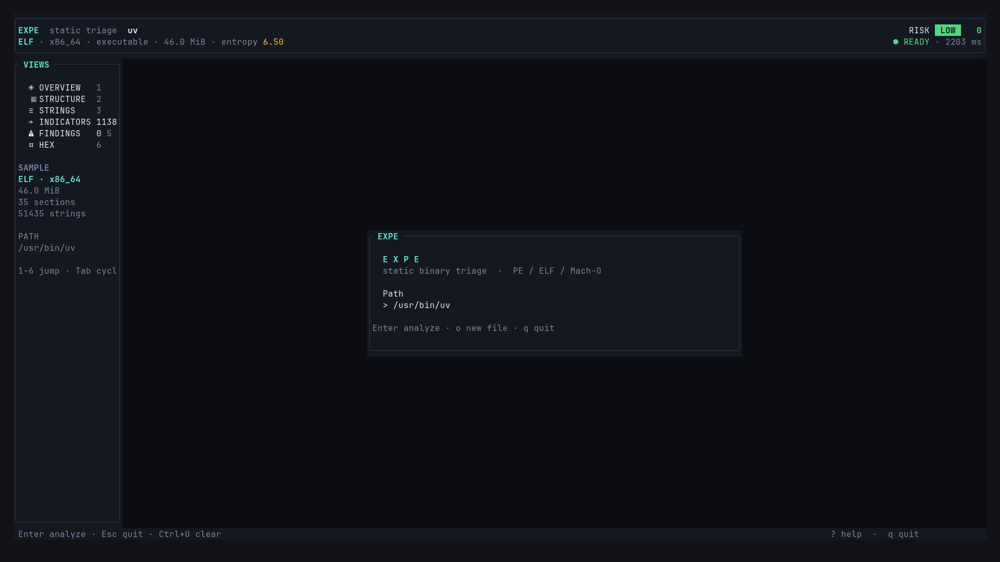
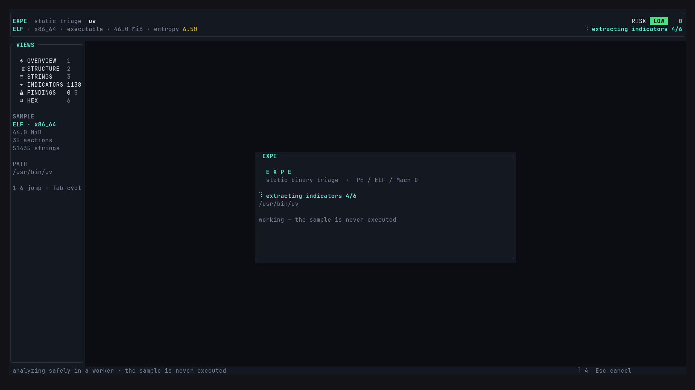
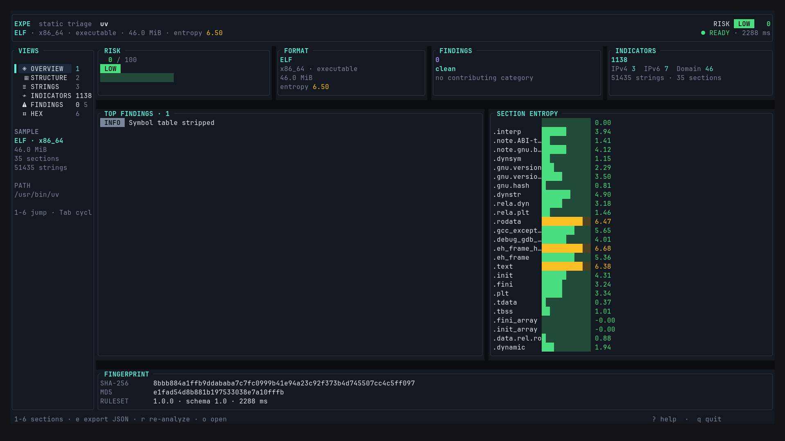
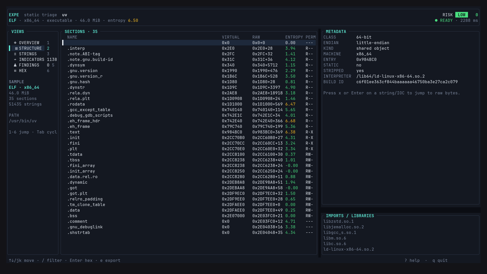
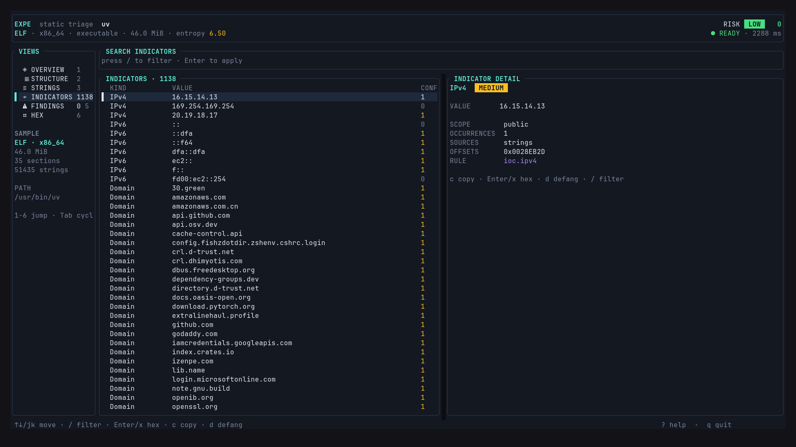
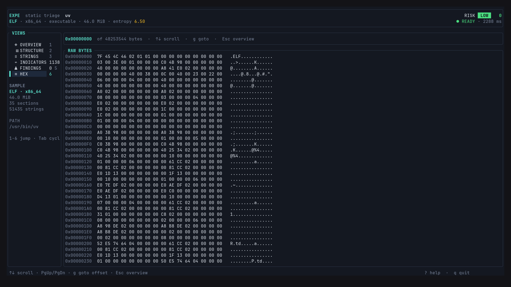

# EXPE

**EXPE** (short for **explore PE**) is a safe, static binary-triage tool for **PE**, **ELF**, and **Mach-O** files. It parses structure, extracts strings and indicators of compromise (IOCs), detects suspicious imports and packer-like sections, scores risk with an explainable model, and emits deterministic reports or an interactive terminal console.

> EXPE never executes, unpacks, or extracts a sample. It reads bytes and reports.

[](https://github.com/buka-pitch/EXPE/actions/workflows/ci.yml)
[](https://www.rust-lang.org/)
[](LICENSE)

## Why EXPE

- **Safe by construction** — read-only ingestion, regular files only, no execution, no unpacking, no archive extraction.
- **Bounded** — file size, scan bytes, strings, IOCs, sections, imports, and symbols all have hard caps. Every truncation is reported.
- **Deterministic** — stable ordering, stable JSON, stable Markdown, and stable exit codes.
- **Explainable** — findings map to categories and ATT&CK techniques; the risk score exposes the factors that produced it.
- **Analyst-friendly** — one-off CLI reports, JSONL batch scans, and a keyboard-driven TUI with hex inspection.

## Features

- PE: headers, sections, imports/exports, overlay, debug/PDB, TLS, .NET flag, signature flag, Rich header flag, version info, imphash.
- ELF: segments, sections, interpreter, libraries, rpath/runpath, build-id, symbols.
- Mach-O: header, segments, dylibs, and entry point.
- ASCII and UTF-16LE string extraction with offsets and occurrence counts.
- IOC extraction for IPs, domains, URLs, emails, registry keys, Windows/Unix paths, mutexes, named pipes, PDB paths, crypto addresses, onion addresses, and embedded PE/ELF images.
- IOC rule packs in TOML, with built-in defaults and user overrides.
- Heuristics for suspicious imports, RWX sections, packer-like sections, entry-point anomalies, high entropy, and more.
- Risk scoring with per-category caps and a low/medium/high/critical verdict.
- Text, JSON, Markdown, and JSONL output; JSON Schema export.
- Interactive TUI with six data views, live filtering, OSC52 copy, JSON export, and hex navigation.

## Screenshots

| Open a sample | Analysis in progress |
|---|---|
|  |  |

| Overview | Structure |
|---|---|
|  |  |

| Indicators | Hex |
|---|---|
|  |  |

## Install

Prebuilt Linux x86-64 binaries are available on the [Releases](https://github.com/buka-pitch/EXPE/releases) page.

Build from source with Rust **1.88 or newer**:

```bash
git clone https://github.com/buka-pitch/EXPE.git
cd EXPE
cargo build --release --locked
./target/release/expe --help
```

Or install the binary into your Cargo bin directory:

```bash
cargo install --path crates/expe-cli --locked
```

## Quick start

```bash
# Full analysis (text by default)
expe analyze ./sample.exe

# Deterministic JSON report
expe analyze ./sample.exe --format json -o sample.expe.json

# Structure only
expe info /bin/ls

# Strings with a regex filter
expe strings ./sample.exe --regex 'https?://' --encoding both --limit 50

# Indicators only
expe iocs ./sample.exe --types ipv4,domain,url

# Scan a directory tree and emit one JSON object per line
expe batch ./samples --recursive --format jsonl --jobs 4

# Interactive console
expe tui ./sample.exe

# Rule pack management and schema export
expe rules list
expe rules check ./my-rules.toml
expe schema
```

Use `expe <command> --help` for every option.

## Commands

| Command | Purpose |
|---|---|
| `expe analyze <PATH>` | Full report: artifact, structure, strings summary, IOCs, findings, risk. |
| `expe info <PATH>` | Normalized structure only. |
| `expe strings <PATH>` | Extract strings with offsets. |
| `expe iocs <PATH>` | Extract indicators only. |
| `expe batch [PATHS]...` | Analyze many files, with optional recursion and a Rayon worker pool. |
| `expe tui [PATH]` | Open the interactive terminal console (`ui` is an alias). |
| `expe rules list [--file <FILE>]` | List the default rules and an optional user pack. |
| `expe rules check <FILE>` | Validate a rule pack and report its rule count. |
| `expe schema` | Print the JSON Schema for analysis reports. |

Common options:

- `--format text|json|markdown` for single-file commands; `text|json|jsonl` for `batch`.
- `-o, --output <FILE>` writes the rendered output instead of stdout.
- `--defang` defangs URLs, domains, IPs, and paths in text/Markdown output.
- `--fail-on low|medium|high|critical` exits with code `1` when a finding meets the threshold.
- `--rules <FILE>` adds or overrides a rule pack (repeatable).
- `--no-default-rules` ignores the embedded rule pack.

### Analyze options

```text
--include-strings      Include the full string list in the report
--min-string-len <N>   Minimum string length (default: 4)
--max-strings <N>      Cap retained strings
--max-iocs <N>         Cap retained IOC values
--max-scan-bytes <N>   Cap bytes scanned for strings/embedded artifacts
```

### Batch options

```text
--recursive            Recurse into directories
--jobs <N>             Worker threads; 0 uses available parallelism
--fail-fast            Stop on the first error or threshold hit
--fail-on <LEVEL>      Return 1 when any report meets the threshold
```

Directories are scanned one level deep by default; `--recursive` walks the whole
tree. Symlinks are skipped, and non-regular files are ignored.

## Exit codes

| Code | Meaning |
|---|---|
| `0` | Success. |
| `1` | `--fail-on` threshold was reached, or `batch` found a matching report. |
| `2` | I/O, parse, unsupported-format, or output error; `batch` also returns this when any input fails. |
| `4` | Configuration or rule-pack error. |

## Interactive TUI

`expe tui` requires a TTY. If `PATH` is omitted, the open screen accepts a typed
path. The console renders every target-derived value through a terminal sanitizer
before it reaches the driver.

### Keybindings

| Key | Action |
|---|---|
| `1`–`6`, `Tab`, `Shift+Tab` | Switch views |
| `↑`, `↓`, `j`, `k` | Move selection; scroll the Hex view by one line |
| `PgUp`, `PgDn` | Jump 10 rows; scroll the Hex view by one page |
| `Home`, `End` | First / last row; top / bottom of the Hex view |
| `/` | Live filter (Structure, Strings, IOCs, Findings) |
| `Enter`, `x` | Jump to hex at the selected offset |
| `c` | Copy the selected value/evidence with OSC52 |
| `d` | Toggle defanged IOC display |
| `e` | Export JSON (`<stem>.expe.json`; adds `-1`, `-2`… instead of overwriting) |
| `r` | Re-analyze the current sample |
| `o` | Open / change the sample |
| `g` | Go to a hex offset (Hex view) |
| `?`, `F1` | Help overlay |
| `Esc` | Cancel analysis, close an overlay, or return to Overview |
| `q`, `Ctrl+C` | Quit |

### Views

1. **Overview** — risk gauge, KPI cards, top findings, section entropy bars, fingerprint.
2. **Structure** — sections/segments, metadata, imports.
3. **Strings** — virtualized list with live regex filtering.
4. **IOCs** — grouped indicators with confidence, sources, and offsets.
5. **Findings** — severity-sorted findings with evidence and ATT&CK mapping.
6. **Hex** — full-width view with adaptive 8–64 bytes per line, line/page scrolling, goto offset, and mark highlighting.

## Output

Single-file reports include:

- tool and schema versions;
- artifact hashes, size, entropy, format, architecture, and kind;
- normalized structure;
- strings summary (and full strings when requested);
- IOC groups with scope, confidence, sources, and offsets;
- findings with severity, category, evidence, and ATT&CK techniques;
- explainable risk factors and verdict;
- limit/truncation notes and timing.

JSON is machine-readable and stable. Text and Markdown sanitize terminal control
characters; JSON preserves the raw values for downstream tooling. Treat all report
content as untrusted.

## Rule packs

Rules are TOML files. A user pack can add rules or override a default rule with the
same `id`.

```toml
version = "1.0.0"

[[rules]]
id = "ioc.custom_domain"
kind = "domain"
severity = "medium"
confidence = "high"
pattern = "custom\\.example\\.com"
validator = "domain"
```

```bash
expe analyze sample.exe --rules ./my-rules.toml
expe rules check ./my-rules.toml
```

## Safety model

- **No execution.** Samples are never run, loaded, or passed to a debugger.
- **Read-only ingestion.** The reader opens regular files only and rejects
  symlinks, directories, devices, and FIFOs.
- **Bounded work.** Defaults are 512 MiB per file, 256 MiB scanned, 100k strings,
  10k IOC values, 256 sections, 50k imports, and 5k symbols. Overrides are
  available through CLI flags where exposed, and every truncation is surfaced in
  the report's `limits` section.
- **Archive rejection.** Archive formats are detected and rejected rather than
  extracted.
- **Panic containment.** Third-party parser calls run inside `catch_unwind`; a
  malformed input becomes a normal parse error instead of taking down the process.
- **Terminal safety.** TUI and text/Markdown output strip control and bidi
  sequences that could spoof a terminal.
- **No network access.** Analysis is local and offline.

Static analysis cannot prove that a file is safe. A clean EXPE report is evidence,
not a guarantee.

## Architecture

```text
crates/
  expe-core      Pure domain models, errors, limits, scores, ports
  expe-engine    Ingestion, PE/ELF/Mach-O parsers, strings, IOC rules,
                 heuristics, analysis pipeline, batch discovery
  expe-tui       Model–view–update terminal console (ratatui + crossterm)
  expe-cli       Clap commands, renderers, and the `expe` binary
  expe-testkit   Deterministic synthetic PE fixtures for tests
```

The engine depends only on `expe-core`; the TUI and CLI are adapters. Parser and
heuristic output is normalized into `AnalysisReport`, so every frontend renders the
same model. The TUI is a pure state machine: keys become messages, only `update`
mutates state, and external work is expressed as effects.

## Development

```bash
cargo fmt --all --check
cargo clippy --workspace --all-targets -- -D warnings
cargo test --workspace --all-targets
cargo +1.88.0 check --workspace --locked   # MSRV
cargo build --release --locked
```

The workspace forbids `unsafe_code` in libraries and enables Clippy's pedantic
lint group. Tests use only synthetic fixtures; no real malware is stored in the
repository. Generated analysis reports (`*.expe.json`) and `target/` are ignored.

## CI

The GitHub Actions workflow runs:

- `rustfmt` check;
- Clippy for all targets with warnings denied;
- the full test suite on Linux, macOS, and Windows;
- a Rust 1.88 MSRV check;
- a locked release build, uploaded as a Linux x86-64 artifact.

## Roadmap

- TUI batch queue, in-app file picker, and command palette.
- Dedicated ELF/Mach-O fixtures and parser tests.
- Fuzz targets, property tests, and Criterion benchmarks.
- `SECURITY.md`, architecture/threat-model docs, and dependency/license checks.

## License

MIT. See [LICENSE](LICENSE).
